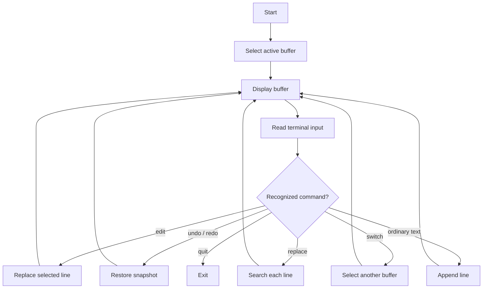

# Multi-Feature Text Editor in C

A small, menu-free terminal text editor written in standard C. The project is an educational exercise in fixed-size data structures, command parsing, terminal output, text manipulation, and undo/redo snapshots.

> **Project status:** prototype / learning project. This program edits text in memory only. It does not open, create, or save files on disk. Do not treat it as a production editor or use it to process untrusted input.

<p align="center">
  
  
  
  
</p>

## Contents
- [What it does](#what-it-does)
- [Current capabilities](#current-capabilities)
- [Known limitations](#known-limitations)
- [Requirements](#requirements)
- [Build and run](#build-and-run)
- [Command reference](#command-reference)
- [How the program works](#how-the-program-works)
- [Repository layout](#repository-layout)
- [Development and validation](#development-and-validation)
- [Documentation](#documentation)
- [Contributing](#contributing)
- [Security](#security)
- [License](#license)

## What it does

The application maintains up to five independent in-memory editor buffers. A user can append lines, replace a line by its one-based line number, undo and redo snapshots, switch the active buffer, and perform a simple word replacement across the current buffer. During display, a small list of C keywords is printed in green using ANSI escape sequences. The program also applies a basic indentation level when a line contains an opening or closing brace.

The implementation is intentionally compact and stores its state in global fixed-size arrays. This makes the code approachable for studying C structs, arrays, pointers, string functions, and control flow. It also creates important constraints that are described below.

## Current capabilities

| Capability | Current behavior | Important detail |
|---|---|---|
| Add text | Any input not recognized as a command is appended as a line | Input is held in a fixed-size character array |
| Edit line | `edit <line-number> <text>` replaces a line | Line numbers start at 1 |
| Undo | Restores a previous snapshot | History is global, not maintained independently per buffer |
| Redo | Restores a state moved out by undo | The history arrays have a fixed capacity |
| Switch buffer | `switch <1-5>` changes the active buffer | Buffers are memory slots, not files |
| Replace | `replace <word> <word>` replaces the first match in each line | Arguments are single words; operation is not recorded in undo history |
| Highlight | A small fixed list of C keywords is colored green | This is token matching, not a full syntax highlighter |
| Indentation | A shared indentation counter responds to braces | It is not a parser and does not understand C syntax |

## Known limitations

These are current implementation facts, not planned features:

1. **No file persistence.** There is no open, save, import, or export operation. All buffers disappear when the process exits.
2. **Fixed capacity.** The source defines 100 lines per buffer, 256 characters per line, 50 history snapshots, and five buffers.
3. **Input handling needs hardening.** The program does not check the return value of `fgets`, and its command parsing is based on fixed-size arrays and `sscanf`.
4. **String operations need bounds checks.** Some paths use `strncpy`, `strcpy`, and `strcat` without a complete capacity strategy. In particular, replacement can build a result larger than the destination.
5. **History is shared.** The undo and redo stacks are global. Switching buffers does not switch to a separate history.
6. **Some edits bypass history.** Find-and-replace does not save a snapshot. Invalid edit attempts currently save a snapshot before validating the line number.
7. **Indentation is shared.** The indentation counter is global and is not part of an `EditorState` snapshot. Switching buffers can therefore carry indentation state across buffers.
8. **Highlighting is approximate.** Tokenization and delimiter reconstruction do not preserve every possible input string exactly. It does not handle comments, strings, preprocessor directives, or language grammar.
9. **Terminal assumptions.** Screen clearing uses `system("clear")` or `system("cls")`; colored output assumes ANSI-compatible terminal behavior.
10. **No automated behavioral test suite yet.** The current workflow verifies compilation. It does not prove that editing commands behave correctly for boundary cases.

Read [Limitations and known issues](docs/LIMITATIONS.md) before extending the program.

## Requirements

- A C compiler with C11 support. GCC is used in the examples and CI.
- A terminal or command prompt.
- Git, if you intend to contribute.

No third-party C libraries are required.

## Build and run

### Linux

From the repository root:

```sh
gcc -std=c11 -Wall -Wextra -pedantic "TEXT EDITOR/main.c" -o text-editor
./text-editor
```

### macOS

Install the Xcode Command Line Tools if a compiler is not already available, then run:

```sh
clang -std=c11 -Wall -Wextra -pedantic "TEXT EDITOR/main.c" -o text-editor
./text-editor
```

### Windows with MinGW-w64

Open PowerShell in the repository root:

```powershell
gcc -std=c11 -Wall -Wextra -pedantic "TEXT EDITOR/main.c" -o text-editor.exe
.\text-editor.exe
```

If the compiler is not found, add the MinGW-w64 `bin` directory to `PATH`. See [Build and portability](docs/BUILD-AND-PORTABILITY.md) for more detail.

### Using Make

If Make is installed:

```sh
make
make run
make clean
```

The Makefile writes the generated executable to `build/text-editor`. Generated output is intentionally ignored by Git.

## Command reference

| Input | Description | Example |
|---|---|---|
| Ordinary text | Appends a line to the active buffer | `A note for later` |
| `edit <line> <text>` | Replaces an existing line | `edit 2 Updated paragraph` |
| `undo` | Restores the most recent saved snapshot | `undo` |
| `redo` | Reapplies a state previously undone | `redo` |
| `replace <find> <replacement>` | Replaces the first occurrence of the search word in each line | `replace draft final` |
| `switch <1-5>` | Selects one of the five in-memory buffers | `switch 2` |
| `quit` | Exits the process | `quit` |

The current parser expects the commands exactly as shown. The replacement command accepts single-word arguments, not phrases containing spaces. There is no built-in help command.

## How the program works

The main loop displays the active buffer, reads one line from standard input, checks whether the input matches a recognized command, performs the operation, and repeats. Unrecognized input is treated as a new text line.

The core data type is `EditorState`, containing a two-dimensional character array and a line count. Five instances are held in the global `files` array. Undo and redo use complete structure copies in two global arrays.



See [Architecture](docs/ARCHITECTURE.md), [Data model and history](docs/DATA-MODEL.md), and [Command reference](docs/COMMAND-REFERENCE.md).

## Repository layout

```text
.
├── .github/
│   ├── ISSUE_TEMPLATE/
│   ├── workflows/quality.yml
│   └── PULL_REQUEST_TEMPLATE.md
├── docs/
│   ├── ARCHITECTURE.md
│   ├── BUILD-AND-PORTABILITY.md
│   ├── COMMAND-REFERENCE.md
│   ├── DATA-MODEL.md
│   ├── LIMITATIONS.md
│   ├── ROADMAP.md
│   ├── TESTING.md
│   └── TROUBLESHOOTING.md
├── TEXT EDITOR/
│   └── main.c
├── CHANGELOG.md
├── CODE_OF_CONDUCT.md
├── CONTRIBUTING.md
├── LICENSE
├── Makefile
├── README.md
├── SECURITY.md
└── SUPPORT.md
```

The repository may also contain a previously committed Windows executable. It is not the canonical source and should not be used as a substitute for compiling the current `main.c`.

## Development and validation

Compile with warnings enabled:

```sh
gcc -std=c11 -Wall -Wextra -pedantic "TEXT EDITOR/main.c" -o build-text-editor
```

The GitHub Actions workflow runs the same compiler family on Ubuntu for pushes and pull requests to `main`. It currently checks compilation only. It does not run an automated test suite or validate interactive behavior.

Before submitting a change, manually test the affected command, empty input, maximum-length input, invalid line numbers, full buffers, undo/redo boundaries, and buffer switching. See [Testing strategy](docs/TESTING.md).

## Documentation

- [Architecture](docs/ARCHITECTURE.md): program structure, control flow, and function responsibilities.
- [Command reference](docs/COMMAND-REFERENCE.md): exact command syntax and current parser behavior.
- [Data model and history](docs/DATA-MODEL.md): buffer layout, fixed capacities, snapshots, and shared state.
- [Build and portability](docs/BUILD-AND-PORTABILITY.md): compiler commands and platform considerations.
- [Testing strategy](docs/TESTING.md): current CI scope and manual regression cases.
- [Limitations](docs/LIMITATIONS.md): known correctness and safety gaps.
- [Roadmap](docs/ROADMAP.md): staged, practical improvements.
- [Troubleshooting](docs/TROUBLESHOOTING.md): common build and runtime issues.

## Contributing

Contributions are welcome, especially fixes that improve memory safety, predictable command behavior, and testability. Read [CONTRIBUTING.md](CONTRIBUTING.md) before opening a pull request. Please do not describe planned capabilities as implemented.

## Security

This is an educational prototype, not a secure general-purpose editor. Review [SECURITY.md](SECURITY.md). Do not use it with untrusted input until the fixed-size buffer and string-handling issues have been resolved.

## License

This project is distributed under the MIT License. See [LICENSE](LICENSE).
