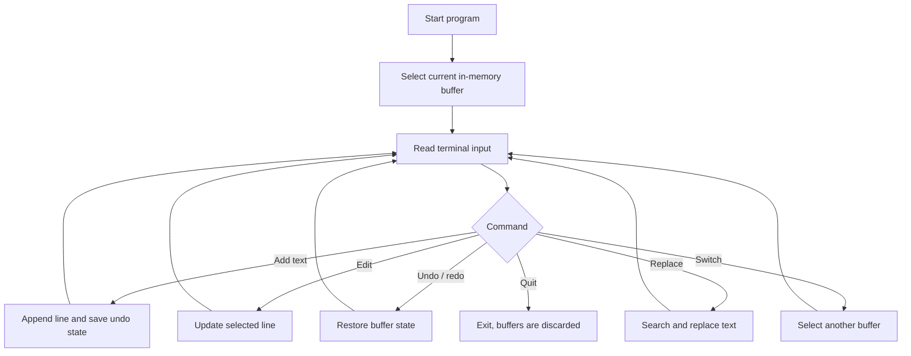

# Multi-Feature Text Editor in C

A small terminal-based text editor written in C. The program keeps up to five editor buffers in memory and demonstrates basic editing operations, undo/redo stacks, simple keyword highlighting, and indentation behavior.

<p align="center">
  
  
  
</p>

## Implemented features

- Add lines to the current in-memory buffer.
- Edit a line by its line number.
- Undo and redo recent buffer states.
- Switch between up to five in-memory buffers.
- Replace a matching word in each line.
- Apply basic indentation changes when lines contain braces.
- Highlight a small set of C keywords in terminal output.

## Important limitation

This is an educational prototype, not a complete file editor. **It does not open or save files to disk.** All text buffers are lost when the program exits. The current implementation also has fixed limits of 100 lines per buffer, 256 characters per line, and 50 undo/redo states. Input parsing and replacement handling need hardening before the program is used with untrusted or large input.

## Requirements

- GCC or another C compiler with C11 support
- A terminal

## Build

From the repository root:

### Linux / macOS

```bash
gcc -std=c11 -Wall -Wextra "TEXT EDITOR/main.c" -o text-editor
./text-editor
```

### Windows with MinGW

```powershell
gcc -std=c11 -Wall -Wextra "TEXT EDITOR/main.c" -o text-editor.exe
.\text-editor.exe
```

## Commands

| Command | Behavior |
|---|---|
| Type text and press Enter | Add a line to the current buffer |
| `edit <line-number> <text>` | Replace the selected line |
| `undo` | Restore the previous stored state |
| `redo` | Reapply an undone state |
| `replace <word> <word>` | Replace the first matching occurrence per line |
| `switch <1-5>` | Switch to an in-memory buffer |
| `quit` | Exit the editor |

The current command parser accepts single-word arguments for `replace`. It does not provide a command history, file picker, save command, or load command.

## Project structure

```text
TEXT EDITOR/
├── main.c       # Editor state, command loop, and editing operations
└── main.exe     # Previously committed Windows executable
```

Build output should be generated locally rather than committed. The source file is the canonical build input.

## Program flow



## Contributing

See [CONTRIBUTING.md](CONTRIBUTING.md). Useful next steps include safe input handling, persistent file I/O, a help command, and tests for buffer and history behavior.

## Security

See [SECURITY.md](SECURITY.md). Do not use this prototype to process untrusted input until its fixed-size buffers and string operations have been hardened.

## License

MIT. See [LICENSE](LICENSE).
