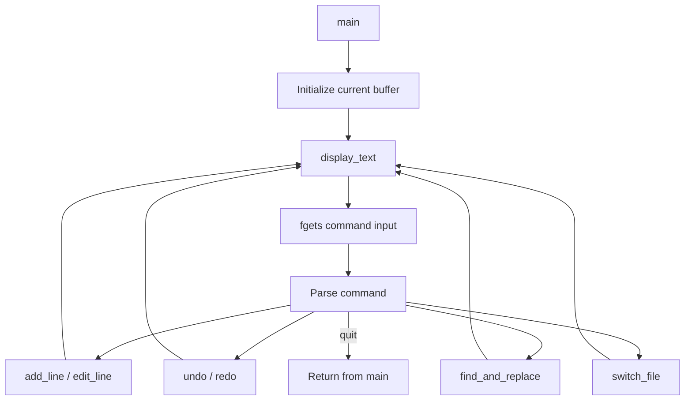

# Architecture

The program is a single-process terminal application implemented in `TEXT EDITOR/main.c`.

## Main data structures

- `EditorState`: fixed-size array of lines and a line count.
- `files`: five in-memory editor states.
- `undo_stack` and `redo_stack`: snapshots of editor state.
- `current_file`: index of the active buffer.

## Main flow

There is no filesystem persistence layer. The editor state exists only in process memory and is discarded at exit.
