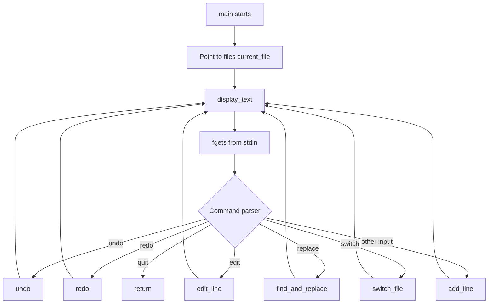

# Architecture and Program Design

## 1. Overview

The application is a single-process, single-source-file C program. The implementation lives in `TEXT EDITOR/main.c`. There is no separate UI layer, storage layer, parser module, or platform abstraction. The terminal is both the input interface and the output surface.

The design is deliberately small, but its global state and fixed-size storage have consequences for correctness. This document describes the current implementation, not an idealized future design.

## 2. Runtime flow

The `main` function obtains a pointer to the active entry in the global `files` array. It then repeatedly:
1. Calls `display_text` to clear the terminal and print the active buffer.
2. Reads a line from standard input using `fgets`.
3. Compares the input against the supported commands.
4. Calls the corresponding operation or treats the input as a new line.
5. Repeats until the exact quit command is received.

The current loop does not check whether `fgets` returned `NULL`. If standard input reaches EOF, the program can repeatedly process stale or unchanged input rather than exiting cleanly. This should be addressed as part of input hardening.

## 3. State ownership

The main state is stored in global variables:

| Symbol | Type | Responsibility |
|---|---|---|
| `files` | `EditorState[MAX_FILES]` | Five independent text buffers |
| `current_file` | `int` | Index of the active buffer |
| `undo_stack` | `EditorState[MAX_HISTORY]` | Previous state snapshots |
| `redo_stack` | `EditorState[MAX_HISTORY]` | States restored by redo |
| `undo_top` | `int` | Last occupied undo slot |
| `redo_top` | `int` | Last occupied redo slot |
| `indent_level` | `int` | Shared indentation counter |
| `keywords` | string array | Small set of highlighted C keywords |

The `EditorState` structure contains `text[MAX_LINES][MAX_LINE_LENGTH]` and an integer `line_count`. The complete structure can be copied with ordinary C structure assignment, which is how history snapshots are stored and restored.

## 4. Function responsibilities

### `save_to_undo`

Copies the supplied editor state into the undo array when capacity remains, then clears the redo stack. Once the undo array reaches its fixed capacity, new snapshots are silently not recorded. There is no rolling-history policy.

### `undo` and `redo`

These functions move complete `EditorState` values between the two global stacks. The stacks are not associated with a specific buffer. The current implementation also assumes that the destination stack has capacity when pushing a state.

### `is_keyword` and `highlight_text`

`is_keyword` compares a token against a small list of C keywords. `highlight_text` tokenizes a copied line and prints matching tokens with ANSI color sequences. This is a display-time transformation and does not update the stored line.

The tokenizer is not a C lexer. It does not understand comments, quoted strings, escaped delimiters, preprocessor directives, or token boundaries in the full language grammar. Its delimiter reconstruction is also approximate.

### `display_text`

Clears the terminal using a shell command selected by the `_WIN32` preprocessor macro, prints a title, then prints each line with the shared indentation level and keyword highlighting. It finishes by printing the input prompt.

### `add_line`

If the active buffer has remaining line capacity, it saves an undo snapshot, adjusts the global indentation counter based on whether the input contains braces, and copies the input into the next line slot. The copy length and null termination need to be made explicit and safe.

### `edit_line`

Saves a snapshot and then checks whether the requested one-based line number is valid. Because validation occurs after snapshot creation, an invalid edit can still consume history capacity. A safer implementation validates first, then records history and performs the mutation.

### `switch_file`

Validates a zero-based index and updates `current_file). The caller then updates its pointer to the newly active buffer. The function name says "file", but these are only memory buffers. No file is read or written.

### `find_and_replace`

Searches each line for the first occurrence of the requested search string and builds a replacement in a fixed local array. It does not record undo history. The current concatenation strategy can overflow if the replacement output is too long, and empty search strings are not explicitly rejected.

## 5. Data and control boundaries

The current architecture has no explicit module boundary between:
- User input and command parsing.
- Command parsing and editor operations.
- Editor state and history.
- Stored text and formatted terminal output.

This makes the code compact but means that input validation and state mutation are spread across functions. A future refactor should introduce a small set of clear boundaries without adding unnecessary frameworks.

A sensible target separation would be:
1. Input reader: obtains a complete line or reports EOF/truncation.
2. Command parser: converts input into a typed command.
3. Editor operations: validate and mutate a supplied editor state.
4. History manager: records and restores state consistently.
5. Renderer: prints text without mutating editor data.
6. Storage adapter: only if file open/save is implemented.

## 6. Current design constraints

- Single-threaded execution.
- Fixed-size arrays and static storage.
- Five buffers maximum.
- One global undo/redo history.
- One global indentation counter.
- No filesystem persistence.
- No automated test harness.
- ANSI color and shell-based screen clearing.

These constraints should be reflected in feature proposals and documentation. See [Data model](DATA-MODEL.md), [Testing](TESTING.md), and [Limitations](LIMITATIONS.md).
